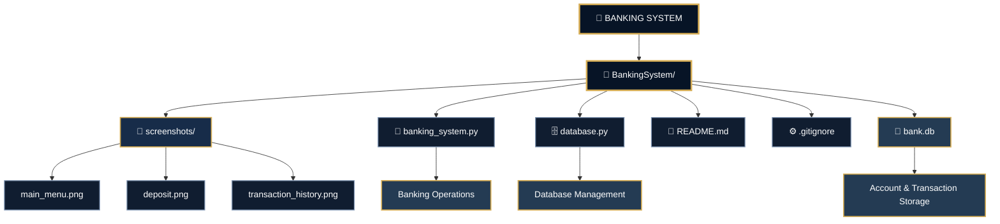

---

The Banking Management System is a console-based banking application developed using Python and SQLite. It provides essential banking operations through a simple and user-friendly interface while maintaining account information and transaction records in a local database.

The application allows users to create bank accounts, securely authenticate using PIN verification, deposit and withdraw money, check account balances, and view transaction history.

It uses PIN hashing, input validation, database error handling, and transaction rollback to improve account security and data reliability.

✨ Key Highlights

- 🏦 Bank account creation and management
- 🔐 Secure PIN hashing and authentication
- 💰 Deposit and withdrawal operations
- 📊 Real-time balance inquiry
- 📜 Transaction history with automatic timestamps
- 🛡️ Input validation and insufficient balance checks
- 🗄️ SQLite database storage
- ⚙️ Database error handling and transaction rollback
- 🇮🇳 Indian Rupee (INR) currency formatting

🎯 Project Objective

To develop a simple and reliable banking application that demonstrates core banking operations, database management, authentication, and secure transaction handling using Python.

🏗️ SYSTEM ARCHITECTURE

The Banking Management System follows a simple application architecture in which the user interacts with the Python application, which processes banking operations and communicates with the SQLite database.

Architecture Workflow

                 👤 USER
                    |
                    ▼
             MAIN MENU
                    |
          ┌─────────┴─────────┐
          ▼                   ▼
      CREATE ACCOUNT        LOGIN
          |                   |
          ▼                   ▼
      PIN HASHING        AUTHENTICATION
          |                   |
          ▼                   ▼
       DATABASE        BANKING OPERATIONS
                             |
                 ┌───────────┼───────────┐
                 ▼           ▼           ▼
              DEPOSIT     WITHDRAW    BALANCE
                 |           |           |
                 └───────────┼───────────┘
                             ▼
                     TRANSACTION HISTORY
                             |
                             ▼
                       SQLITE DATABASE

## 🏗️ Project Structure – Architecture Diagram

  
  

  <b>🏦 BANKING & FINANCE</b> &nbsp; | &nbsp; <b>🔐 ACCOUNT SECURITY</b>

